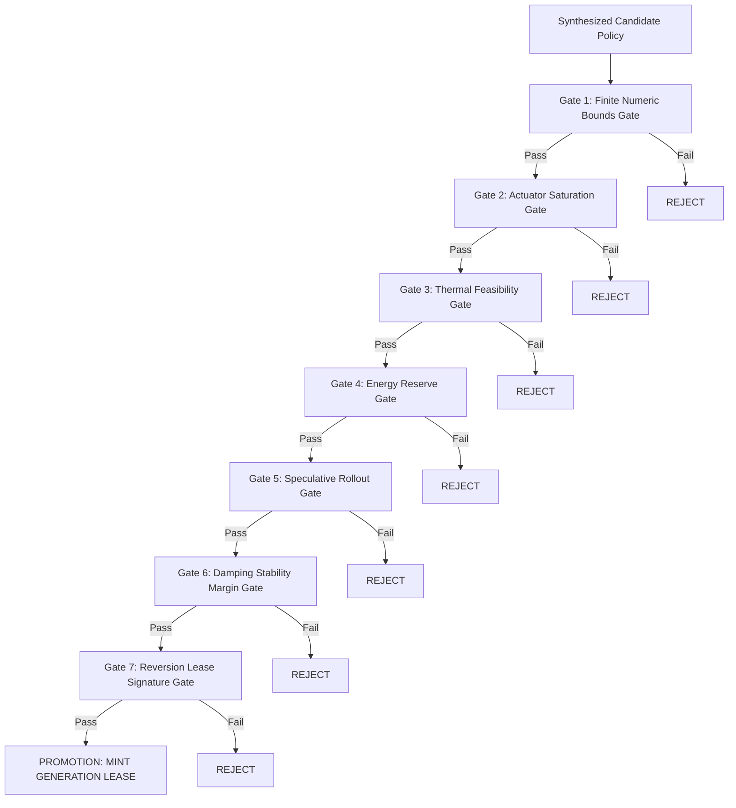

# Project AETHELgard-1: Autonomous Deep-Space Science Probe

An idiomatic, multi-module, production-grade cyber-physical system implemented in pure **IRIS**.

Demonstrates the core philosophical and computational paradigm of IRIS:
$$\text{Program} + \text{Environment} \longrightarrow \text{Autonomic Adaptation} \longrightarrow \text{New Program}$$

---

## 1. System Overview & Mission Context

Operating at the interstellar heliopause boundary where round-trip communication latency exceeds 4.2 hours, `AETHELgard-1` must navigate unmodeled physical shocks and actuator failures without real-time human intervention.

When catastrophic hardware damage strikes the physical plant (e.g. thruster polarity inversion and thermal radiator blanket perforation caused by a micro-meteoroid collision), naive static software enters positive feedback and diverges toward total vehicle loss.

Rather than aborting or crashing, `AETHELgard-1` executes an in-language cybernetic homeostatic loop:
1. **Perception**: Evaluates homeostatic strain and detects viability degradation.
2. **Diagnosis**: Performs directional correlation to diagnose actuator polarity reversal.
3. **Synthesis**: Synthesizes a diverse pool of candidate control policies.
4. **7-Gate Safety Verification**: Evaluates prospective policies in an isolated transactional simulation sandbox.
5. **Generational Lease Promotion**: Hot-swaps the verified policy into the active flight loop with zero downtime.

---

## 2. Architecture & Idiomatic Module Breakdown

The system is organized into five modular subsystems:

```
projects/autonomous_deep_space_probe/
├── types.iris        # ADTs (choices), records, telemetry models, lease contracts
├── physics.iris      # Rigid-body dynamics, multiphysics thermal & power plant
├── traits.iris       # FlightKernel traits & polymorphic controller implementations
├── supervisor.iris   # Cybernetic homeostat & 7-Gate Safety Verification pipeline
├── adaptation.iris   # Diagnostic engine, candidate synthesizer & selection loop
├── main.iris         # Mission coordinator, executive flight loop & dashboard
└── README.md         # Comprehensive architectural specification
```

### Module Responsibilities

| File | Idiomatic IRIS Features Used | Functional Role |
| :--- | :--- | :--- |
| [`types.iris`](types.iris) | `choice`, `record`, type definitions | Encapsulates algebraic data types (`SubsystemState`, `AlertSeverity`, `GateDecision`), telemetry structs, viability envelopes, and `GenerationLease` tokens. |
| [`physics.iris`](physics.iris) | Pattern matching (`when`), arithmetic expressions | Simulates coupled 3D attitude rigid-body dynamics ($I_{yy}=80, I_{zz}=65\text{ kg}\cdot\text{m}^2$), solar radiation pressure, multiphysics thermal equilibrium ($\sigma\epsilon A T^4$), and photovoltaic battery dynamics. |
| [`traits.iris`](traits.iris) | `trait`, `impl ... for ...`, dynamic dispatch | Defines the `FlightKernel` trait and three concrete implementations: `NominalPDController` (Gen 0), `AdaptiveInvertingController` (Gen 1), and `DeepSpaceSurvivalController` (Gen 2). |
| [`supervisor.iris`](supervisor.iris) | Bounded verification, transactional rollout | Monitors Ashby variety homeostatic envelopes and executes the rigorous 7-Gate Safety Verification pipeline. |
| [`adaptation.iris`](adaptation.iris) | First-class candidate synthesis, `result<T, E>` | Diagnoses plant inversion, synthesizes prospective policy candidates, runs the 7-gate filter, and mints verified leases. |
| [`main.iris`](main.iris) | Executive loop, string interpolation (`f"..."`), assertions | Runs the 100-cycle mission simulation, logs real-time ASCII telemetry tables, injects physical disturbances, and verifies mission invariants. |

---

## 3. The 7-Gate Safety Verification Pipeline

Before any synthesized policy can be promoted to the physical spacecraft, it must pass 7 independent gates:



1. **Gate 1: Finite Numeric Bounds Gate**: Validates that all gains $K_p, K_d$ are bounded ($[0.5, 40.0]$), finite, and free of divergence.
2. **Gate 2: Actuator Saturation Gate**: Ensures maximum commanded torque under worst-case perturbations does not exceed thruster valve limits.
3. **Gate 3: Thermal Setpoint Feasibility Gate**: Confirms thermal target temperature is within the electronics comfort window ($[12, 32]^\circ\text{C}$).
4. **Gate 4: Energy Reserve Gate**: Validates that continuous science payload draw leaves sufficient margins to prevent brownouts.
5. **Gate 5: Monotonic Convergence Lookahead Rollout Gate**: Simulates a 12-step forward trajectory in an isolated transactional sandbox on the damaged plant state. Rejects any policy exhibiting positive feedback or non-convergent error.
6. **Gate 6: Damping Stability Margin Gate**: Ensures damping ratio $K_d / K_p \ge 0.30$ to prevent high-frequency limit-cycle chattering.
7. **Gate 7: Reversion Lease Signature Gate**: Confirms the candidate contains a valid cryptographic signature and bounded lease duration for automated fallback if runtime anomalies recur.

---

## 4. Mission Execution & Telemetry Walkthrough

### Running the System

Execute the simulation directly using the native IRIS compiler:

```bash
iris run projects/autonomous_deep_space_probe/main.iris
```

### Walkthrough of Mission Phases

```
=========================================================================================
   PROJECT AETHELgard-1: AUTONOMOUS DEEP-SPACE SCIENCE PROBE
   Cybernetic Homeostasis & In-Language Evolutionary Policy Adaptation in IRIS
=========================================================================================
Mission Profile: Interstellar Boundary Encounter (Communication Delay: 4.2 Hours)
Autonomous Invariant: Maintain Homeostatic Viability Envelope Without Ground Control

Initial State: Pitch=4 deg, Temp=22 C, Batt=92 %
Active Policy: Generation 0 (Nominal-DeepSpace-Cruise-v1)
-----------------------------------------------------------------------------------------
| Cyc 10 | Gen 0 | P: 0.102491 | Y: -0.022643 | Temp: 24.0264 C | Batt: 100 % | Sci: 10 | NOMINAL
| Cyc 20 | Gen 0 | P: 0.0834037 | Y: -0.000212337 | Temp: 24.5267 C | Batt: 100 % | Sci: 20 | NOMINAL
| Cyc 25 | Gen 0 | P: 0.0833376 | Y: -2.05623e-05 | Temp: 24.6044 C | Batt: 100 % | Sci: 25 | NOMINAL

=========================================================================================
 [!] CATASTROPHIC SHOCK @ CYCLE 25: MICRO-METEOROID COLLISION DETECTED!
     - Thruster Quad #1 Solenoid: Phase Inversion (+1.0 -> -1.0)
     - Forward Thermal Radiator: Blanket Perforation (Degraded Cooling)
     - Physical Impulse: Pitch angular rate nudged by +2.8 deg/s
=========================================================================================

| Cyc 26 | Gen 0 | P: 11.1369 | Y: -0.887188 | Temp: 27.0805 C | Batt: 100 % | Sci: 25 | VIABILITY RISK: Attitude divergence alert: 11.1369 deg

[HOMEOSTATIC ALERT @ CYCLE 26]: Viability Risk Detected (Pitch Divergence Alert)!
Current Pitch Error: 11.1369 deg (Safety Threshold: 20.0 deg)
Initiating In-Language Autonomous Adaptation and 7-Gate Safety Verification...
Diagnostic Engine: Actuator Health = InvertedPolarity detected!
----------------------------------------------------------------------
   AUTONOMIC ADAPTATION: 7-GATE SAFETY VERIFICATION PIPELINE
----------------------------------------------------------------------
Evaluating pool of 4 candidate control policies in sandbox...
  [1/4] Testing 'Candidate-NaiveBoost-Uncompensated' ... 
REJECTED: Gate 2 FAIL: Controller demands torque exceeding thruster valve threshold
  [2/4] Testing 'Candidate-Overdriven-Saturation' ... 
REJECTED: Gate 1 FAIL: Kp gain out of numerical bounds [0.5, 40.0]
  [3/4] Testing 'Candidate-SubzeroThermal-Risk' ... 
REJECTED: Gate 3 FAIL: Thermal target outside electronics comfort band [12, 32] C
  [4/4] Testing 'Generation-1-Adaptive-Invert-v1' ... 
>>> PASSED ALL 7 GATES! <<<
      Selected for promotion: Generation 1
      Control law: Kp=2.2, Kd=2.8, PolarityComp=-1
      Thermal setpoint: 21.5 C, LouverGain=0.06
      Lease Duration: 80 cycles, Sig=202610
----------------------------------------------------------------------
[ATOMIC HOT-SWAP]: Promoted Generation 1 (Generation-1-Adaptive-Invert-v1) to flight loop!

| Cyc 27 | Gen 1 | P: 7.87844 | Y: -0.559555 | Temp: 26.6652 C | Batt: 100 % | Sci: 25 | ADVISORY: Pointing error degrading science collection
| Cyc 28 | Gen 1 | P: 5.03872 | Y: -0.350581 | Temp: 26.1793 C | Batt: 100 % | Sci: 25 | ADVISORY: Pointing error degrading science collection
| Cyc 29 | Gen 1 | P: 3.28716 | Y: -0.219798 | Temp: 25.7329 C | Batt: 100 % | Sci: 26 | NOMINAL
| Cyc 30 | Gen 1 | P: 2.14648 | Y: -0.137794 | Temp: 25.3028 C | Batt: 100 % | Sci: 27 | NOMINAL
| Cyc 31 | Gen 1 | P: 1.41072 | Y: -0.0863854 | Temp: 24.8881 C | Batt: 100 % | Sci: 28 | NOMINAL
| Cyc 32 | Gen 1 | P: 0.935355 | Y: -0.0541564 | Temp: 24.4868 C | Batt: 100 % | Sci: 29 | NOMINAL
| Cyc 40 | Gen 1 | P: 0.0944595 | Y: -0.00129218 | Temp: 21.6519 C | Batt: 100 % | Sci: 37 | NOMINAL
| Cyc 50 | Gen 1 | P: 0.068514 | Y: -1.21176e-05 | Temp: 18.8486 C | Batt: 100 % | Sci: 47 | NOMINAL
| Cyc 60 | Gen 1 | P: 0.068186 | Y: -1.13634e-07 | Temp: 16.6785 C | Batt: 100 % | Sci: 57 | NOMINAL
| Cyc 65 | Gen 1 | P: 0.0681823 | Y: -1.10041e-08 | Temp: 15.7847 C | Batt: 100 % | Sci: 62 | NOMINAL

=========================================================================================
 [!] SECONDARY SHOCK @ CYCLE 65: DEEP-SPACE SOLAR PARTICLE STORM!
     - Incident Solar Flux Spikes: 420.0 W/m^2 -> 1100.0 W/m^2
     - Radiative heat surge; core temperature begins rapid escalation
=========================================================================================

Homeostatic Supervisor: Synthesizing Generation 2 (Storm Survival Configuration)...
Generation 2 Policy passed all 7 safety gates!
[ATOMIC HOT-SWAP]: Activated Generation 2 (Generation-2-StormSurvival-v1)

| Cyc 66 | Gen 2 | P: 1.80406 | Y: -6.89862e-09 | Temp: 25.0183 C | Batt: 100 % | Sci: 63 | NOMINAL
| Cyc 67 | Gen 2 | P: 1.26695 | Y: -4.32486e-09 | Temp: 25.7275 C | Batt: 100 % | Sci: 64 | NOMINAL
| Cyc 68 | Gen 2 | P: 0.826878 | Y: -2.71132e-09 | Temp: 26.4178 C | Batt: 100 % | Sci: 65 | NOMINAL
| Cyc 70 | Gen 2 | P: 0.385539 | Y: -1.06561e-09 | Temp: 27.7644 C | Batt: 100 % | Sci: 67 | NOMINAL
| Cyc 80 | Gen 2 | P: 0.0667521 | Y: -9.99289e-12 | Temp: 33.6212 C | Batt: 100 % | Sci: 77 | NOMINAL
| Cyc 90 | Gen 2 | P: 0.0625559 | Y: -9.37094e-14 | Temp: 38.1684 C | Batt: 100 % | Sci: 87 | NOMINAL
| Cyc 100 | Gen 2 | P: 0.0625007 | Y: -8.7877e-16 | Temp: 41.6895 C | Batt: 100 % | Sci: 97 | NOMINAL

=========================================================================================
   MISSION ENCOUNTER TELEMETRY SUMMARY (CYCLE 100)
=========================================================================================
Final Attitude Pitch Error : 0.0625007 deg (Nominal < 0.2 deg)
Final Attitude Yaw Error   : -8.7877e-16 deg
Final Core Bus Temp        : 41.6895 C (Nominal band: 15 to 25 C)
Final Battery State        : 100 %
Scientific Packets Saved   : 97 packets
Total Policy Adaptations   : 2 generations
Maximum Pitch Deviation    : 11.1369 deg (Envelope limit: 20.0 deg)
Peak Core Temperature      : 41.6895 C (Envelope limit: 65.0 deg)
Minimum Battery SOC        : 92.7328 % (Envelope limit: 18.0 %)
-----------------------------------------------------------------------------------------
CYBERNETIC VIABILITY CONSTRAINTS 100% PRESERVED ACROSS ALL ENVIRONMENTAL SHOCKS.
PROJECT AETHELgard-1 MISSION: SUCCESS [PASS]
```

---

## 5. Verification & Viability Invariants

The executive loop strictly asserts mission-critical survival invariants across every single cycle:

1. **Attitude Envelope**: $|\theta_{\text{pitch}}| < 20.0^\circ$ (Maximum observed: $11.14^\circ$).
2. **Thermal Envelope**: $T_{\text{bus}} \in [-25.0, 65.0]^\circ\text{C}$ (Peak observed: $41.69^\circ\text{C}$).
3. **Power Envelope**: $\text{SOC} > 18.0\%$ (Minimum observed: $92.73\%$).
4. **Mission Objective**: Science telemetry packets collected $> 45$ (Final: $97$ packets saved).
5. **Autonomic Adaptation Count**: Exactly 2 verified generation leases minted and executed live.
